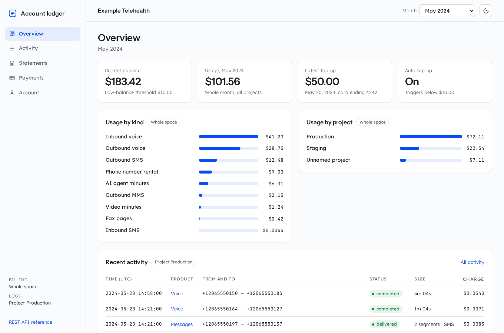
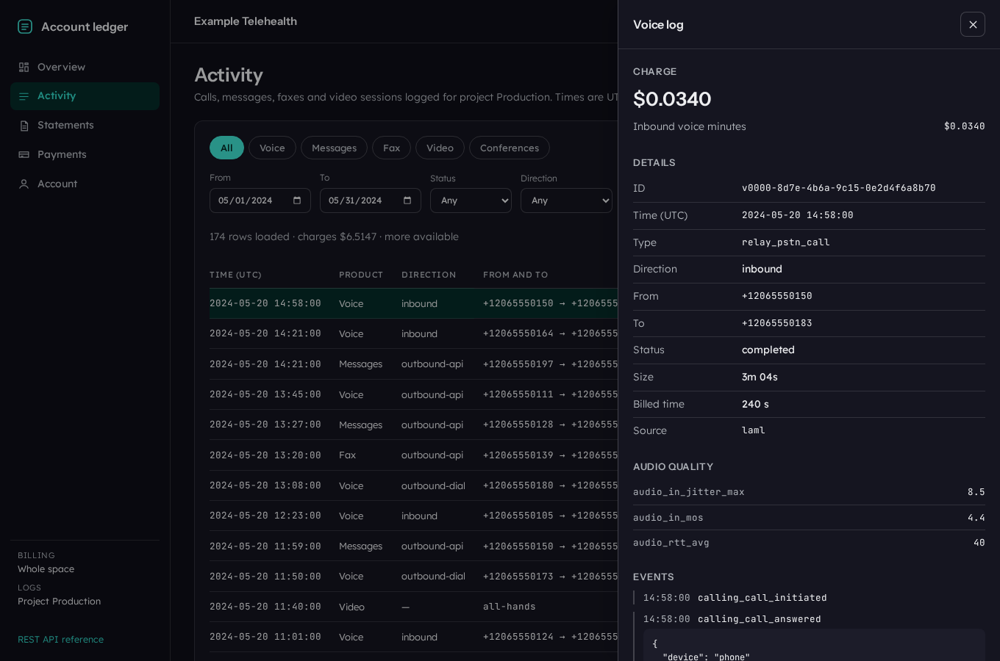
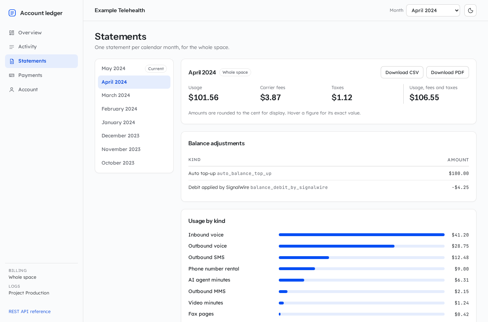

# SignalWire account ledger

A small, read-only web app that shows a SignalWire space's billing and activity in one place,
built on the documented REST APIs:

- **Overview**: current balance, usage for the month by kind and by project, the latest top-up,
  and the most recent activity.
- **Activity**: voice, messaging, fax and video logs in one table, with conference logs on their
  own tab. Open a row for its charge details and, for calls, the event timeline and audio quality.
- **Statements**: each month's statement, with CSV and PDF downloads.
- **Payments**: top-ups, auto top-ups, and credits or debits applied to the balance.
- **Account**: the billing profile, cards on file and low-balance settings.

The app only reads. It sends `GET` requests and nothing else, so it cannot top up a balance,
change a setting or remove a card.



| Activity, with a call's details open | A month's statement |
|---|---|
|  |  |

The screenshots use made-up sample data. The app follows your system's light or dark setting,
and the button in the top bar switches between them.

## Requirements

- Python 3.11 or later
- A SignalWire space, with the two credentials below

## Credentials

The Logs APIs and the Billing APIs take different credentials, so the app uses both. Either one
can be left out; the views that need it explain what is missing and the rest still work.

| Variable | What it is | Used for |
|---|---|---|
| `SIGNALWIRE_SPACE` | Your space: `example` or `example.signalwire.com` | Every request |
| `SIGNALWIRE_PROJECT_ID`, `SIGNALWIRE_API_TOKEN` | A project ID and an API token with the Voice, Messaging, Fax and Video scopes | Activity (the Logs APIs) |
| `SIGNALWIRE_PAT` | A [Personal access token](https://signalwire.com/docs/apis/authorization#personal-access-tokens), created from your user menu in the Dashboard. You must be an owner or admin of the space | Overview, Statements, Payments, Account |

A project API token is not accepted on the billing endpoints, and a Personal access token has
no scopes: your role in the space decides what it can read.

Treat the Personal access token like your own login. It carries your owner or admin role and
cannot be limited to reading, even though this app only reads with it. Keep it in `.env`, never
in a commit, and revoke it when you no longer need the app.

Logs belong to one project, the one the API token was issued for. Billing covers the whole
space, broken down by project. Each view says which of the two it is showing.

## Reading the numbers

The charge total on the Activity view will not match your statement, and is not meant to:

- It adds up the rows loaded on the page, for one project. Load more rows and it grows.
- The statement covers every project in the space and every kind of usage, including charges
  that are not tied to a single call, message, fax or video session.

For what the space was billed, use Statements. Use Activity to see what an individual call or
message cost and why.

## Run it

```bash
cp .env.example .env        # then fill in the values
pip install -r requirements.txt
python -m ledger
```

Open http://127.0.0.1:8000. Set `LEDGER_PORT` to use another port.

`scripts/smoke_test.sh` calls each endpoint once and prints the HTTP status, which is a quick way
to check the credentials and the token's scopes.

The repository includes a dev container that installs the requirements and passes `.env` into
the container.

## Keeping it private

The app shows billing data and has no login of its own, so it is built to stay on your machine:

- It listens on `127.0.0.1` only and answers only requests addressed to `localhost` or
  `127.0.0.1`. To reach it through a forwarded hostname, list that hostname in
  `LEDGER_ALLOWED_HOSTS` (comma-separated).
- The credentials stay in the server process. The browser talks only to the app and never
  receives a token.
- Nothing is written to disk. Data is read from the API when a page loads, and a few answers are
  kept in memory for up to five minutes.
- Pages load their typefaces from Google Fonts; no account data is part of those requests.

## How it works

```
ledger/
  config.py     reads the environment (or .env) at start-up
  client.py     GET-only HTTP client: the two credentials, paging, error messages
  logs.py       the Logs APIs, and one row shape for every product
  billing.py    statements, usage, payment history, balance, billing profile
  money.py      microdollar arithmetic and formatting
  web/          the pages (FastAPI, Jinja templates, one stylesheet, one script)
tests/          run against a stand-in API with synthetic records
```

A few details worth knowing if you reuse the code:

- **Paging** follows the `links.next` URL of each response, which already carries the filters
  and the `page_token`. Only its path and query are used, against your own space.
- **Amounts** from the billing endpoints are summed in microdollars (millionths of a dollar),
  which the API returns as integers, and formatted only for display. Log charges arrive in
  dollars and are converted the same way before they are added up.
- **Date ranges** on the log lists ask for one extra day on each side and trim the result, so
  the range shown is exact however the API treats the days named in `created_after` and
  `created_before`.
- **Conference logs** include video room sessions that are also in the video logs, so they are
  shown on their own tab and left out of the combined view and its charge total.
- **The statement PDF** endpoint answers with a redirect to the stored file. The app follows it
  without sending the Personal access token to the file host.

## API reference

Logs (project ID and API token):

- [List voice logs](https://signalwire.com/docs/apis/rest/voice-logs/list-voice-logs),
  [Get voice log](https://signalwire.com/docs/apis/rest/voice-logs/get-voice-log),
  [List voice log events](https://signalwire.com/docs/apis/rest/voice-logs/list-voice-log-events)
- [List message logs](https://signalwire.com/docs/apis/rest/message-logs/list-message-logs),
  [Get message log](https://signalwire.com/docs/apis/rest/message-logs/get-message-log)
- [List fax logs](https://signalwire.com/docs/apis/rest/fax-logs/list-fax-logs),
  [Get fax log](https://signalwire.com/docs/apis/rest/fax-logs/get-fax-log)
- [List video logs](https://signalwire.com/docs/apis/rest/video-logs/list-logs),
  [Get video log](https://signalwire.com/docs/apis/rest/video-logs/get-log)
- [List conference logs](https://signalwire.com/docs/apis/rest/conference-logs/list-conferences)

Billing and balance (Personal access token):

- [List statement periods](https://signalwire.com/docs/apis/rest/space/billing/list-billing-statements),
  [Retrieve a statement](https://signalwire.com/docs/apis/rest/space/billing/get-billing-statement),
  as [CSV](https://signalwire.com/docs/apis/rest/space/billing/get-billing-statement-csv)
  or [PDF](https://signalwire.com/docs/apis/rest/space/billing/get-billing-statement-pdf)
- [Retrieve usage](https://signalwire.com/docs/apis/rest/space/billing/get-usage)
- [List payment history](https://signalwire.com/docs/apis/rest/space/billing/list-payment-history)
- [Retrieve the billing profile](https://signalwire.com/docs/apis/rest/space/billing/get-billing-profile),
  [List payment methods](https://signalwire.com/docs/apis/rest/space/billing/list-payment-methods)
- [Retrieve the balance](https://signalwire.com/docs/apis/rest/space/balance/get-balance),
  [Retrieve low balance settings](https://signalwire.com/docs/apis/rest/space/balance/get-low-balance-setting)
- [Retrieve the space](https://signalwire.com/docs/apis/rest/space/get-space),
  [List projects](https://signalwire.com/docs/apis/rest/projects/list-projects)

## Tests

```bash
pip install -r requirements-dev.txt
pytest
```

The tests never contact SignalWire. They serve the app from a stand-in API whose records are
synthetic and shaped like the examples in the API reference.

## License

MIT
